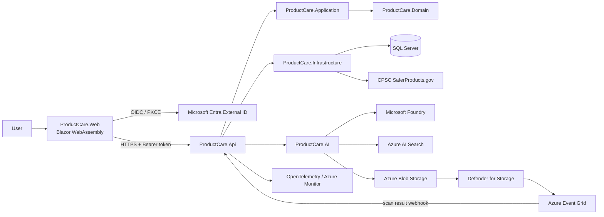

# ProductCare AI

ProductCare is an authenticated, AI-assisted product support application built with .NET 10 and Microsoft Foundry.

The project demonstrates how AI capabilities can be integrated into a conventional application architecture without making the UI, domain model, persistence, authorization rules, or security boundaries dependent on model behavior. Current workflows include product identification from images, saved-product ownership, malware-scanned manual ingestion and grounded Q&A, CPSC recall checks, a code-defined ephemeral agent with persistent conversation context, access approval, daily AI quotas, observability, and Azure deployment.

The project is designed as a low-traffic portfolio and interview environment. It is intentionally not presented as production-scale infrastructure.

## Highlights

- **Image-based product identification** with structured model output and explicit uncertainty.
- **Saved products scoped to the authenticated owner** by tenant and user identifiers.
- **Malware-gated product-manual ingestion** using Blob Storage, Defender for Storage, Event Grid, and Azure AI Search.
- **Grounded manual Q&A** using semantic + vector retrieval, validated citations, and no fallback to unsupported model knowledge.
- **ProductCare Assistant** implemented as a code-defined ephemeral agent over the Foundry Responses API, with explicit application tools and bounded tool rounds.
- **Prompt-injection defenses** using Foundry guardrails, untrusted-document boundaries, application-controlled tools, and citation validation.
- **Persistent Foundry conversations** associated with individual saved products.
- **Microsoft Entra External ID** authentication with server-side authorization and access approval.
- **Daily per-user AI quotas** persisted in SQL Server with concurrency-safe consumption.
- **OpenTelemetry + Azure Monitor/Application Insights** integration for assistant traces and metrics.
- **Automated CI/CD** for the Blazor client and containerized API.

## Architecture



`ProductCare.Web` is a standalone API client. It has no project reference to the backend projects, so a different web or mobile client can use the same API without redesigning the Domain, Application, Infrastructure, or AI projects.

The manual-ingestion path is intentionally event driven. A newly uploaded PDF is excluded from Azure AI Search until Defender for Storage reports a clean result. Event Grid then notifies the API, which revalidates the event against the current blob before releasing the file for indexing.

## Solution Structure

```text
src/
├── ProductCare.Web
├── ProductCare.Api
├── ProductCare.Application
├── ProductCare.Domain
├── ProductCare.Infrastructure
└── ProductCare.AI

tests/
├── ProductCare.UnitTests
└── ProductCare.IntegrationTests

docs/
├── adr/
├── architecture.md
├── cost-budget.md
├── environments.md
├── product-scope.md
└── threat-model.md
```

## Technology

| Area | Current implementation |
| --- | --- |
| Runtime | .NET 10 |
| Client | Standalone Blazor WebAssembly |
| API | ASP.NET Core Web API |
| Authentication | Microsoft Entra External ID + MSAL |
| API authorization | Microsoft Identity Web, delegated `access_as_user` scope, application policies |
| Persistence | EF Core 10 + SQL Server |
| AI / agent orchestration | Microsoft Foundry project client + Responses API |
| AI safety | Microsoft Foundry guardrails + application-side validation |
| Retrieval | Azure AI Search semantic + vector search |
| Manual storage | Azure Blob Storage |
| Manual malware scanning | Microsoft Defender for Storage |
| Scan-result delivery | Azure Event Grid custom topic + HTTPS webhook |
| Product safety | CPSC SaferProducts.gov REST API |
| Observability | OpenTelemetry + Azure Monitor/Application Insights |
| API hosting | Azure Container Apps |
| Web hosting | Azure Static Web Apps |
| Container registry | Azure Container Registry |
| Tests | xUnit v3, ASP.NET Core integration tests, Testcontainers for SQL Server |
| CI/CD | GitHub Actions |

## Core Workflows

### Product identification

The user uploads a JPEG, PNG, or WebP image up to 5 MB.

The API validates the declared media type and the file signature before invoking the AI service. The Foundry integration uses a strict JSON schema for manufacturer, model number, product type, product name, confidence, and text visibly observed in the image.

The model is explicitly instructed not to invent manufacturer, model, product name, or observed text when the image does not support them.

### Product ownership

Saved products are associated with both the authenticated tenant ID and user ID.

Repository reads and conversation updates include both ownership fields in the database predicate. A product identifier supplied by the client is therefore not sufficient to access another user's data.

### Product manuals and grounded Q&A

A product manual can be uploaded only after the saved product has a manufacturer and model number.

The API performs basic file validation before storage:

- PDF only;
- maximum size of 15 MB;
- `.pdf` extension validation;
- `%PDF-` file-signature validation;
- one current manual per saved product.

A successful upload is **not** immediately trusted or indexed. ProductCare writes the blob with `AzureSearch_Skip=true`, so the Azure AI Search blob indexer ignores both the file content and metadata while the file is waiting for its security result.

Defender for Storage performs on-upload malware scanning. Scan results are delivered through Event Grid. ProductCare releases a manual only when all of the following are true:

1. the Event Grid message is a clean Defender malware-scan result;
2. the blob URI belongs to the configured ProductCare storage account/container/path;
3. the scanned ETag still matches the current blob;
4. the current Defender blob index tag is `No threats found`.

Only then does ProductCare remove `AzureSearch_Skip` and start the configured Azure AI Search indexer. A malicious, unscanned, failed, stale, or otherwise non-clean result never releases the blob. The deployed storage account also uses Defender's soft-delete-malicious-blobs option as an additional remediation control.

Manual state is reported as `NotUploaded`, `PendingSecurityScan`, `SecurityRejected`, `SecurityScanFailed`, `PendingIndexing`, `Ready`, or `Failed`. The status endpoint reports state only; it does not drive the security workflow.

For a manual question, ProductCare:

1. derives the saved product key from manufacturer and model number;
2. filters retrieval to the matching product and uploaded product ID where applicable;
3. combines semantic search with vector search;
4. retrieves up to eight manual chunks;
5. wraps retrieved text as untrusted document content before model invocation;
6. requires structured output containing `answerFound`, citation IDs, and the answer;
7. validates model-provided citation IDs against the retrieved sources before returning the answer.

If the retrieved material does not support an answer, ProductCare reports that the information could not be found in the available manual instead of filling the gap from general model knowledge.

### ProductCare Assistant

The assistant provides one conversational entry point for product-specific help.

It is implemented as a **code-defined ephemeral agent** using the Foundry Responses API. The agent definition—model, instructions, tools, and orchestration rules—lives in the .NET codebase and is versioned with the application rather than as a separately maintained prompt-agent resource.

A configurable router deployment decides whether to:

- search the product manual;
- check official CPSC recall information;
- use both capabilities; or
- answer ordinary conversational messages without a tool.

The available tools are application-defined and executed by ProductCare code. The model does not receive arbitrary HTTP, SQL, file-system, or code-execution capabilities. Tool execution is bounded to four follow-up rounds.

Manual-related follow-up questions are rewritten into self-contained search queries using the existing conversation context. The grounded answer itself is still generated from current Azure AI Search results rather than relying on previous model text as product evidence.

The router and grounded-answer deployments use the configured Foundry guardrail policy. Requests blocked by the service content filter are translated into a normal validation failure instead of being exposed as an internal server error.

For the manual fast path, grounded answer text is streamed through the API as NDJSON while citations and final metadata are returned in the completed response.

### Persistent conversations

Each saved product can hold one active Foundry conversation ID.

The conversation is created lazily on the first assistant question and the ID is persisted with the product. Subsequent questions reuse the same Foundry conversation so references such as "that step" or "why?" can be resolved against earlier turns.

Starting a new conversation disconnects the stored conversation ID first and then performs best-effort deletion of the previous Foundry conversation. A new conversation is created on the next question.

The browser transcript is presentation state only; ProductCare does not currently reload a persisted transcript into the UI.

### Recall checks

Recall data comes from the U.S. Consumer Product Safety Commission service rather than model memory.

ProductCare searches by model number and performs normalized model matching against returned recall records. If the CPSC source cannot be reached or parsed, the service reports the source as unavailable rather than treating the failure as "no recalls."

The assistant is also instructed never to present the absence of a matching recall as proof that a product is safe.

## Authentication and Access

ProductCare uses Microsoft Entra External ID.

The Blazor WebAssembly client:

- is a public OAuth client;
- uses redirect-based MSAL authentication;
- requests the delegated ProductCare API scope;
- sends bearer tokens to `ProductCare.Api`;
- contains no privileged Azure credential.

The API defines three authorization levels:

- `ProductCare.User` — authenticated user with the `access_as_user` delegated scope.
- `ProductCare.ActiveUser` — authenticated user with the required scope and active ProductCare access.
- `ProductCare.Admin` — authenticated user with the required scope and the `ProductCare.Admin` application role.

New users can view their access state and submit an access request. Approval and rejection are administrator operations. Access-request submission is rate limited to five requests per ten-minute window per authenticated user, with remote IP fallback for an unauthenticated partition.

## Usage Quotas

AI usage is limited per user and UTC day.

The default repository configuration is:

| Operation | Daily limit |
| --- | ---: |
| Product identification | 20 |
| Product manual questions | 50 |
| Product assistant | 50 |

Quota counters are persisted in SQL Server. Consumption uses conditional database updates and a unique-counter creation path to prevent concurrent requests from bypassing the configured limit.

When a quota is exhausted, the API returns HTTP `429` with `ProblemDetails`, a `Retry-After` header, the operation, daily limit, and UTC reset time.

## Observability

When an Application Insights connection string is configured, the API registers OpenTelemetry with Azure Monitor.

Current assistant telemetry includes:

- request count;
- failure count;
- tool-call count;
- request duration;
- assistant activities;
- Foundry/Azure project tracing sources.

GenAI message-content tracing is only enabled when the API is running in Development and `Observability:CaptureGenAIContent` is enabled.

Every API request receives a new `X-Correlation-ID`. The same value becomes the ASP.NET Core trace identifier and is included in the logging scope.

## API Error Handling

Application validation, conflict, and quota exceptions are handled centrally and returned as safe `ProblemDetails` responses.

Unexpected exceptions are logged server-side and return a generic client message rather than internal exception details. Problem responses include a trace ID for troubleshooting.

## Deployment

### Web

`ProductCare.Web` is deployed through Azure Static Web Apps.

The GitHub workflow builds the standalone Blazor WebAssembly project, and `staticwebapp.config.json` rewrites unmatched routes to `index.html` for client-side routing.

### API

`ProductCare.Api` is published as a multi-stage .NET 10 container listening on port `8080`.

On pushes to `main`, the deployment workflow:

1. restores the local .NET tools;
2. restores the API;
3. checks for pending EF Core model changes;
4. creates a self-contained EF Core migration bundle;
5. validates required GitHub/Azure deployment configuration;
6. signs in to Azure using GitHub OIDC;
7. builds and pushes the API image to Azure Container Registry;
8. applies database migrations;
9. configures the Container App registry to use managed identity;
10. updates the Azure Container App to the image tagged with the Git commit SHA.

Production Azure SDK access from the API uses the Container App's system-assigned managed identity. Local development uses a chained developer credential based on Visual Studio, Azure CLI, and Azure PowerShell.

## CI and Testing

The main CI workflow runs on pushes and pull requests to `main`:

```text
restore
  ↓
build --configuration Release
  ↓
test --configuration Release --no-build
```

Current tests cover areas including:

- domain behavior;
- access-request and user-account rules;
- user identity;
- product rules;
- product knowledge keys;
- quota behavior;
- domain dependency boundaries;
- health endpoints;
- correlation IDs;
- authenticated system endpoints;
- product repository ownership with SQL Server integration tests.

Integration tests use `Microsoft.AspNetCore.Mvc.Testing` and Testcontainers for SQL Server.

## Local Development

### Prerequisites

- .NET 10 SDK
- Visual Studio or another .NET 10-capable IDE
- access to the configured Microsoft Entra External ID tenant
- access to the required Microsoft Foundry, Azure AI Search, Blob Storage, and SQL resources
- one supported Azure developer sign-in for local Azure SDK authentication

### Server-side configuration

Do not commit secrets or privileged credentials.

The API expects environment-specific configuration for these sections:

```text
AzureAd
ConnectionStrings:ProductCareDatabase
Foundry
ProductKnowledgeSearch
ProductManualIngestion
ProductManualSecurity
UsageQuotas
ApplicationInsights
Observability
Cors
```

The AI/manual configuration includes:

```text
Foundry:
  TenantId
  ProjectEndpoint
  ModelDeployment
  RouterDeployment

ProductKnowledgeSearch:
  TenantId
  Endpoint
  IndexName
  SemanticConfigurationName

ProductManualIngestion:
  StorageServiceUri
  ContainerName
  IndexerName

ProductManualSecurity:
  EventGridWebhookSecret
```

`ProductManualSecurity:EventGridWebhookSecret` is a server-side secret. In local development it belongs in .NET User Secrets. In Azure Container Apps it is supplied through a secret-backed environment variable (`ProductManualSecurity__EventGridWebhookSecret`).

Use .NET User Secrets for local server values that should not be committed.

### Web configuration

The WebAssembly client requires only public client configuration:

```text
AzureAd:
  Authority
  ClientId
  ValidateAuthority
  KnownAuthorities

ProductCareApi:
  BaseUrl
  Scope
```

The client must never contain a client secret, database credential, Foundry key, Search key, or Storage key.

### Run

Restore and build from the repository root:

```powershell
dotnet restore
dotnet build
```

Then run `ProductCare.Api` and `ProductCare.Web` using the normal Visual Studio multi-project launch profile or separate terminals.

## Design Principles

ProductCare keeps security and business authority in deterministic server-side controls:

- identity and authorization;
- product ownership;
- quota enforcement;
- upload validation and malware-scan gating;
- CPSC recall retrieval;
- citation validation;
- database persistence;
- tool execution boundaries;
- release of uploaded manuals to Search.

User prompts, uploaded documents, retrieved chunks, and tool output are treated as untrusted input. Models are used for interpretation and generation, but they are not trusted to authorize access, approve a file, decide ownership, establish recall truth, or validate their own citations.

## Documentation

- [Architecture](docs/architecture.md)
- [Product scope](docs/product-scope.md)
- [Threat model](docs/threat-model.md)
- [Environments](docs/environments.md)
- [Cost and budget controls](docs/cost-budget.md)
- [ADR 001: Standalone Blazor WebAssembly Client](docs/adr/001-frontend-client.md)

## Project Status

The current portfolio milestone supports an end-to-end authenticated demo:

```text
Sign in
  → request / receive access
  → identify or save a product
  → upload a manual
  → Defender scan + Event Grid approval
  → Azure AI Search indexing
  → ask grounded product questions
  → use ProductCare Assistant for follow-up help
  → check CPSC recall information
  → review AI usage
```


