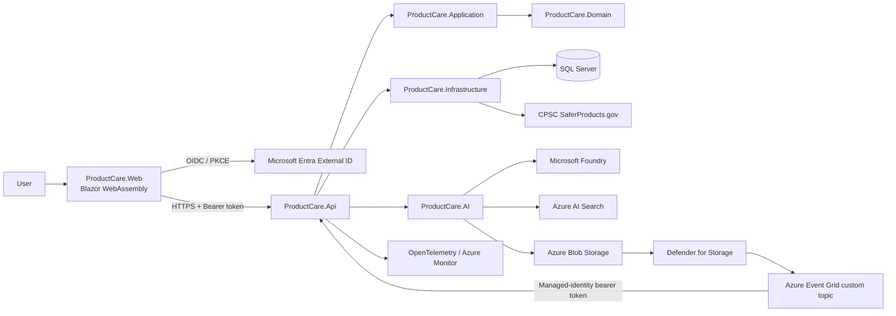

# ProductCare AI

ProductCare is an authenticated product-support application built with .NET 10, Microsoft Foundry, Azure AI Search, Azure Blob Storage, Microsoft Defender for Storage, and Azure Container Apps.

The application keeps identity, authorization, ownership, persistence, usage controls, file approval, and external safety data in deterministic application code. AI is used where language understanding, retrieval, generation, and tool selection add value, but model output is not treated as an authorization or data-integrity boundary.

## Capabilities

- Image-based product identification with structured model output and explicit uncertainty.
- Saved products scoped to the authenticated tenant and user.
- Product-manual upload with file validation, Defender for Storage malware scanning, Event Grid approval, and Azure AI Search indexing.
- Grounded product-manual Q&A using semantic and vector retrieval with validated citations.
- ProductCare Assistant implemented with the Foundry Responses API, application-defined tools, bounded tool execution, streaming, and persistent per-product conversation context.
- CPSC recall checks using the authoritative external service rather than model memory.
- Microsoft Entra External ID authentication with application-level access approval.
- Persisted daily AI usage quotas with concurrency-safe consumption.
- OpenTelemetry and Azure Monitor/Application Insights integration.
- GitHub Actions CI/CD for the web client and containerized API.

## Architecture



`ProductCare.Web` is a standalone API client. It has no project reference to the backend implementation projects. The API remains the security and application boundary, so another browser or mobile client can use the same backend contracts without changing the Domain, Application, Infrastructure, or AI layers.

The manual-ingestion path is event driven. Uploaded PDFs remain excluded from Azure AI Search until Defender for Storage reports a clean scan. Event Grid delivers the scan result to a protected API webhook using the custom topic's system-assigned managed identity. ProductCare validates the Event Grid token, the blob location, the event ETag, and the current Defender scan-result tag before releasing the file for indexing.

## Solution Structure

```text
src/
├── ProductCare.Web
├── ProductCare.Api
├── ProductCare.Application
├── ProductCare.Domain
├── ProductCare.Infrastructure
└── ProductCare.AI

tests/
├── ProductCare.UnitTests
└── ProductCare.IntegrationTests

docs/
├── adr/
├── architecture.md
├── cost-budget.md
├── environments.md
├── product-scope.md
└── threat-model.md
```

## Technology

| Area | Current implementation |
| --- | --- |
| Runtime | .NET 10 |
| Client | Standalone Blazor WebAssembly |
| API | ASP.NET Core Web API |
| Customer authentication | Microsoft Entra External ID + MSAL |
| API authorization | Microsoft Identity Web, delegated `access_as_user` scope, application policies |
| Event Grid webhook authentication | Microsoft Entra bearer token from the Event Grid topic system-assigned managed identity |
| Persistence | EF Core 10 + SQL Server |
| AI / orchestration | Microsoft Foundry + Responses API |
| AI safety | Foundry guardrails + application-side validation |
| Retrieval | Azure AI Search semantic + vector retrieval |
| Manual storage | Azure Blob Storage |
| Manual malware scanning | Microsoft Defender for Storage |
| Scan-result delivery | Azure Event Grid custom topic + authenticated HTTPS webhook |
| Product safety | CPSC SaferProducts.gov REST API |
| Observability | OpenTelemetry + Azure Monitor/Application Insights |
| API hosting | Azure Container Apps |
| Web hosting | Azure Static Web Apps |
| Container registry | Azure Container Registry |
| Tests | xUnit v3, ASP.NET Core integration tests, Testcontainers for SQL Server |
| CI/CD | GitHub Actions |

## Core Workflows

### Product Identification

The user uploads a JPEG, PNG, or WebP image up to 5 MB.

The API validates the declared media type and file signature before invoking the model. The identification service requires structured output for manufacturer, model number, product type, product name, confidence, and observed text.

The model is instructed to preserve uncertainty. Unsupported manufacturer, model, product name, or observed text is not filled with a guess.

### Product Ownership

Saved products are associated with the authenticated tenant ID and user ID.

Repository reads and updates include both ownership values in the database predicate. A product ID supplied by the client is therefore not sufficient to access another user's product.

### Product Manuals and Grounded Q&A

A product manual can be uploaded only after the saved product has a manufacturer and model number.

The API validates:

- PDF extension;
- `application/pdf` content type;
- `%PDF-` file signature;
- maximum size of 15 MB;
- one current manual per saved product.

A successful upload is not immediately trusted or indexed. ProductCare stores the PDF in the existing private manual container with `AzureSearch_Skip=true`, which prevents the Azure AI Search blob indexer from ingesting it while security approval is pending.

Defender for Storage performs on-upload malware scanning and publishes scan results to an Event Grid custom topic. The Event Grid subscription calls the ProductCare webhook using the custom topic's system-assigned managed identity.

The webhook uses a dedicated bearer-token authentication scheme. ProductCare accepts the delivery only when:

1. the Microsoft Entra token is valid for the configured Event Grid webhook audience;
2. the token is issued by the configured Azure resource tenant;
3. the token's object ID matches the configured Event Grid topic managed identity;
4. the event contains a clean Defender malware-scan result;
5. the blob URI belongs to the configured ProductCare storage account, container, and upload path;
6. the scanned ETag matches the current blob;
7. the current Defender blob index tag is exactly `No threats found`.

Only after those checks does ProductCare remove `AzureSearch_Skip`, record the approved scan ETag in blob metadata, and start the Azure AI Search indexer.

The API status endpoint reports state only. Refreshing the UI does not approve or release a manual.

Manual states are:

- `NotUploaded`
- `PendingSecurityScan`
- `SecurityRejected`
- `SecurityScanFailed`
- `PendingIndexing`
- `Ready`
- `Failed`

For a manual question, ProductCare:

1. derives the product knowledge key from the saved manufacturer and model number;
2. filters retrieval to the matching product and uploaded product ID where applicable;
3. combines semantic and vector retrieval;
4. retrieves a bounded set of candidate chunks;
5. wraps retrieved text as untrusted document content before model invocation;
6. requires structured output containing `answerFound`, citation IDs, and the answer;
7. validates every model-provided citation ID against the retrieved source set.

If the retrieved material does not support an answer, ProductCare returns a no-answer result instead of filling the gap from general model knowledge.

### ProductCare Assistant

The assistant provides a single conversational entry point for product-specific help.

It is implemented as application-controlled orchestration over the Foundry Responses API. Model configuration, instructions, tools, and orchestration rules are versioned with the application.

A configurable router decides whether a request requires:

- product-manual retrieval;
- a CPSC recall lookup;
- both capabilities; or
- no external tool.

Tools are defined and executed by ProductCare. The model is not given arbitrary HTTP, SQL, file-system, or code-execution access. Tool execution is bounded.

Manual-related follow-up questions are rewritten into self-contained search queries using conversation context. The evidence for the answer is still retrieved again from Azure AI Search for each manual question.

The router and grounded-answer deployments use the configured Foundry guardrail policy. Content-filter failures are translated into controlled application errors rather than exposed as internal failures.

Grounded answer text is streamed through the API while the completed structured result remains subject to server-side validation.

### Persistent Conversations

Each saved product can hold one active Foundry conversation ID.

The conversation is created lazily on the first assistant request and the ID is persisted with the product. Follow-up requests reuse that conversation so references such as "that step" can be resolved against earlier turns.

Starting a new conversation disconnects the stored conversation ID first and performs best-effort deletion of the previous remote conversation. The next question creates a new conversation.

The browser transcript is presentation state and is not currently reloaded as a persisted message history.

### Recall Checks

Recall data comes from the U.S. Consumer Product Safety Commission service rather than model memory.

ProductCare searches by model number and performs normalized model matching against returned recall records. If the source is unavailable or cannot be parsed, the application reports the source as unavailable instead of treating the failure as "no recalls."

The absence of a matching recall is not presented as proof that a product is safe.

## Authentication and Authorization

### Customer Access

ProductCare uses Microsoft Entra External ID for customer authentication.

The Blazor WebAssembly client:

- is a public OAuth client;
- uses redirect-based MSAL authentication;
- requests the delegated ProductCare API scope;
- sends bearer tokens to `ProductCare.Api`;
- contains no privileged Azure credential.

The API defines application authorization levels:

- `ProductCare.User` — authenticated user with the required delegated scope.
- `ProductCare.ActiveUser` — authenticated user with the required scope and active ProductCare access.
- `ProductCare.Admin` — authenticated user with the required scope and the administrative application role.

New users can view their access state and submit an access request. Approval and rejection are administrator operations.

### Event Grid Webhook Access

The malware-scan webhook does not use customer authentication and does not use a query-string secret.

The Event Grid custom topic has a system-assigned managed identity. The event subscription uses that identity when delivering events to the webhook. A dedicated Microsoft Entra application registration defines the token audience.

The API validates Event Grid deliveries through a separate JWT bearer scheme and authorization policy. Configuration contains:

```text
EventGridAuthentication:
  TenantId
  Audience
  AllowedCallerObjectId
```

`TenantId` is the Azure resource tenant that issues the Event Grid delivery token.

`Audience` is the application/client ID configured as the Event Grid webhook audience.

`AllowedCallerObjectId` is the object/principal ID of the Event Grid custom topic's system-assigned managed identity.

These values are identifiers, not shared credentials. They remain environment-specific and should not be hard-coded into source.

## Usage Controls

AI usage is limited per user and UTC day.

Default limits are:

| Operation | Daily limit |
| --- | ---: |
| Product identification | 20 |
| Product manual questions | 50 |
| Product assistant | 50 |

Quota counters are persisted in SQL Server. Consumption uses conditional database updates and a unique-counter creation path to prevent concurrent requests from bypassing the configured limit.

When a quota is exhausted, the API returns HTTP `429` with `ProblemDetails`, `Retry-After`, the operation, the daily limit, and the UTC reset time.

Access-request submission also uses a fixed-window rate limit.

General API-wide throttling is not currently enabled.

## Observability

When an Application Insights connection string is configured, the API registers OpenTelemetry with Azure Monitor.

Current assistant telemetry includes:

- request count;
- failure count;
- tool-call count;
- request duration;
- assistant activities;
- Foundry/Azure tracing sources.

GenAI message-content tracing is enabled only when the API runs in Development and `Observability:CaptureGenAIContent` is enabled.

Each API request receives a new `X-Correlation-ID`. The same value is used as the ASP.NET Core trace identifier and is included in the logging scope.

## API Error Handling

Application validation, conflict, and quota exceptions are handled centrally and returned as safe `ProblemDetails` responses.

Unexpected exceptions are logged server-side and return a generic client response. Problem responses include a trace ID for correlation with server telemetry.

## Deployment

### Web

`ProductCare.Web` is deployed through Azure Static Web Apps.

The GitHub workflow builds the standalone Blazor WebAssembly project. `staticwebapp.config.json` rewrites unmatched routes to `index.html` for client-side routing.

### API

`ProductCare.Api` is published as a multi-stage .NET 10 container listening on port `8080`.

On pushes to `main`, the deployment workflow:

1. restores local .NET tools;
2. restores the API;
3. checks for pending EF Core model changes;
4. creates a self-contained EF Core migration bundle;
5. validates required GitHub/Azure deployment configuration;
6. signs in to Azure using GitHub OIDC;
7. builds and pushes the API image to Azure Container Registry;
8. applies database migrations;
9. configures Container Apps registry access through managed identity;
10. updates the Container App to the image tagged with the Git commit SHA.

Azure SDK access from the deployed API uses the Container App's system-assigned managed identity. Local development uses supported developer credentials.

## CI and Testing

The main CI workflow runs on pushes and pull requests to `main`:

```text
restore
  ↓
build --configuration Release
  ↓
test --configuration Release --no-build
```

Current automated coverage includes:

- domain and access rules;
- quota behavior;
- architecture dependency rules;
- correlation IDs;
- health endpoints;
- authenticated system behavior;
- product ownership against SQL Server.

Integration tests use `Microsoft.AspNetCore.Mvc.Testing` and Testcontainers for SQL Server.

## Local Development

### Prerequisites

- .NET 10 SDK
- Visual Studio or another .NET 10-capable IDE
- access to the configured Microsoft Entra External ID tenant
- access to the required Microsoft Foundry, Azure AI Search, Blob Storage, and SQL resources
- a supported Azure developer sign-in for local Azure SDK authentication

### Server-side Configuration

Do not commit credentials, connection strings, or privileged secrets.

The API expects environment-specific configuration for these sections:

```text
AzureAd
ConnectionStrings:ProductCareDatabase
Foundry
ProductKnowledgeSearch
ProductManualIngestion
EventGridAuthentication
UsageQuotas
ApplicationInsights
Observability
Cors
```

The AI/manual-related configuration includes:

```text
Foundry:
  TenantId
  ProjectEndpoint
  ModelDeployment
  RouterDeployment

ProductKnowledgeSearch:
  TenantId
  Endpoint
  IndexName
  SemanticConfigurationName

ProductManualIngestion:
  StorageServiceUri
  ContainerName
  IndexerName

EventGridAuthentication:
  TenantId
  Audience
  AllowedCallerObjectId
```

For local development, environment-specific server values can be stored in .NET User Secrets. The Event Grid values enable the Event Grid webhook policy locally, although a local API will not receive Azure Event Grid deliveries unless a public HTTPS endpoint is explicitly configured for that purpose.

### Web Configuration

The WebAssembly client contains only public client configuration:

```text
AzureAd:
  Authority
  ClientId
  ValidateAuthority
  KnownAuthorities

ProductCareApi:
  BaseUrl
  Scope
```

The client must not contain a client secret, database credential, Foundry key, Search key, Storage key, or other privileged server credential.

### Run

From the repository root:

```powershell
dotnet restore
dotnet build
dotnet test --configuration Release
```

Run `ProductCare.Api` and `ProductCare.Web` using the Visual Studio multi-project launch profile or separate terminals.

## Security Principles

ProductCare keeps security and business authority in deterministic server-side controls:

- identity and authorization;
- product ownership;
- access approval;
- quota enforcement;
- upload validation and malware-scan gating;
- authenticated Event Grid delivery;
- CPSC recall retrieval;
- citation validation;
- database persistence;
- tool execution boundaries;
- release of uploaded manuals to Search.

User prompts, uploaded files, retrieved chunks, tool output, and model output are treated as untrusted input.

## Documentation

- [Architecture](docs/architecture.md)
- [Product scope](docs/product-scope.md)
- [Threat model](docs/threat-model.md)
- [Environments](docs/environments.md)
- [Cost and budget controls](docs/cost-budget.md)
- [ADR 001: Standalone Blazor WebAssembly Client](docs/adr/001-frontend-client.md)
