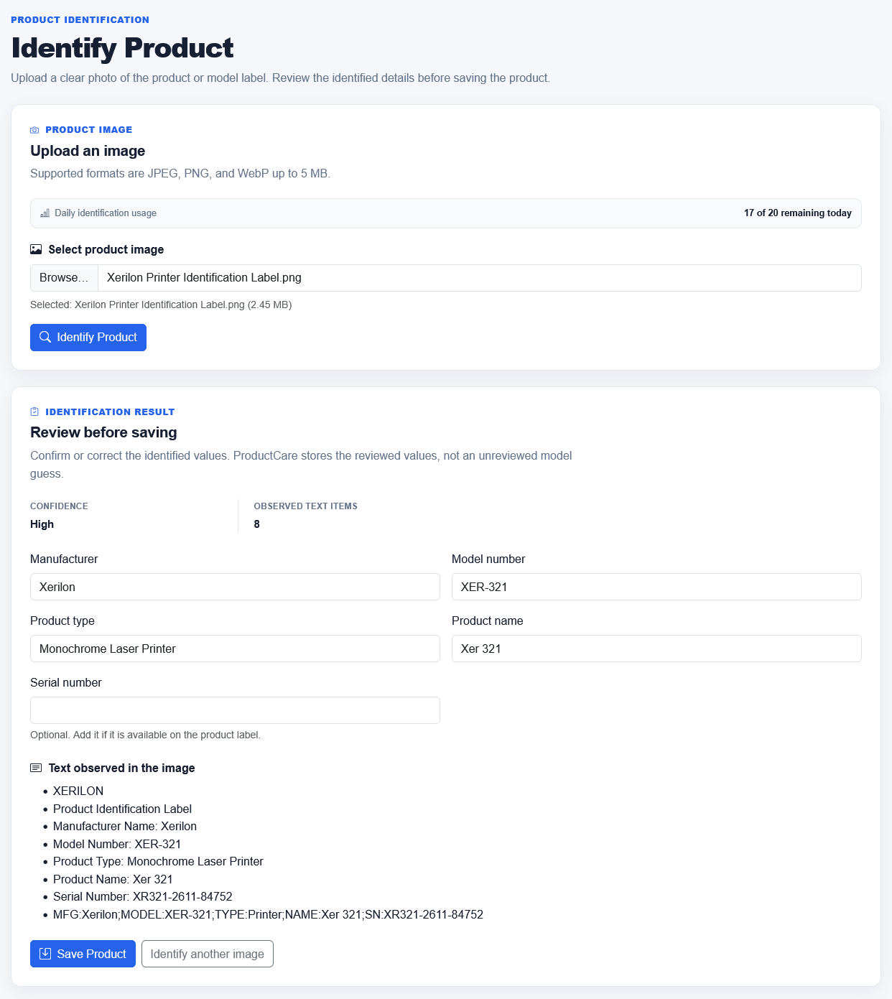
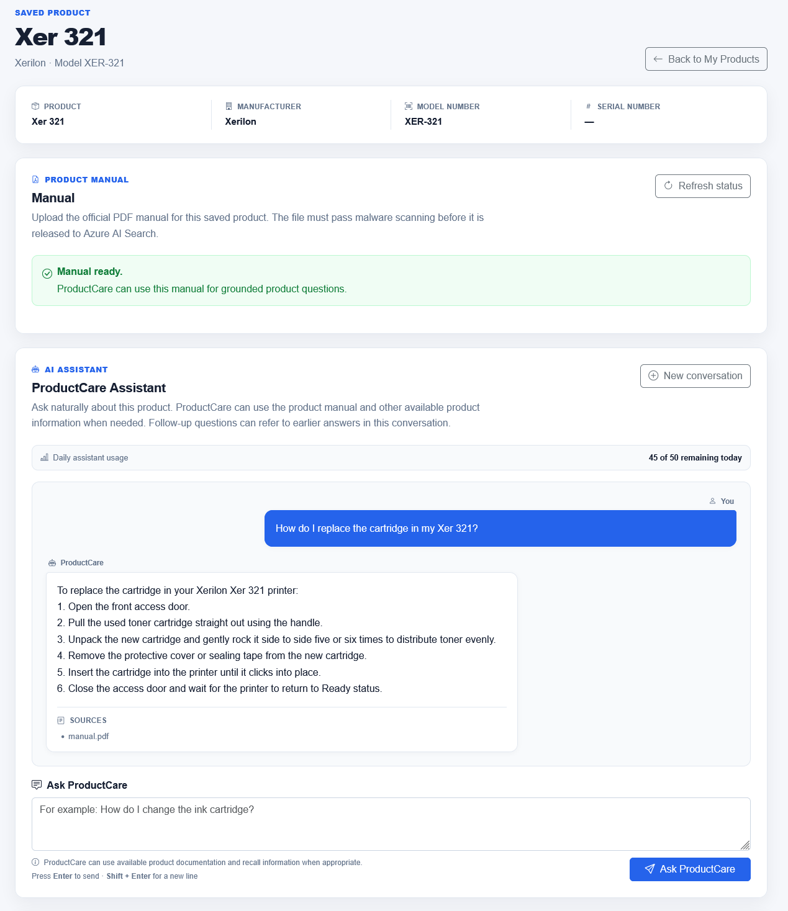
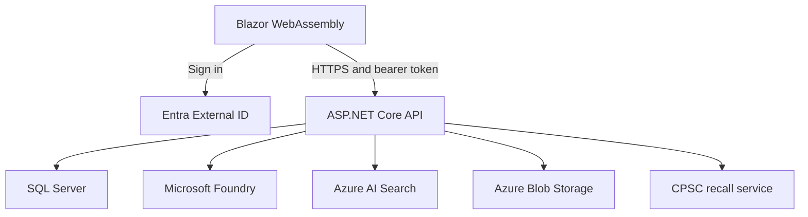
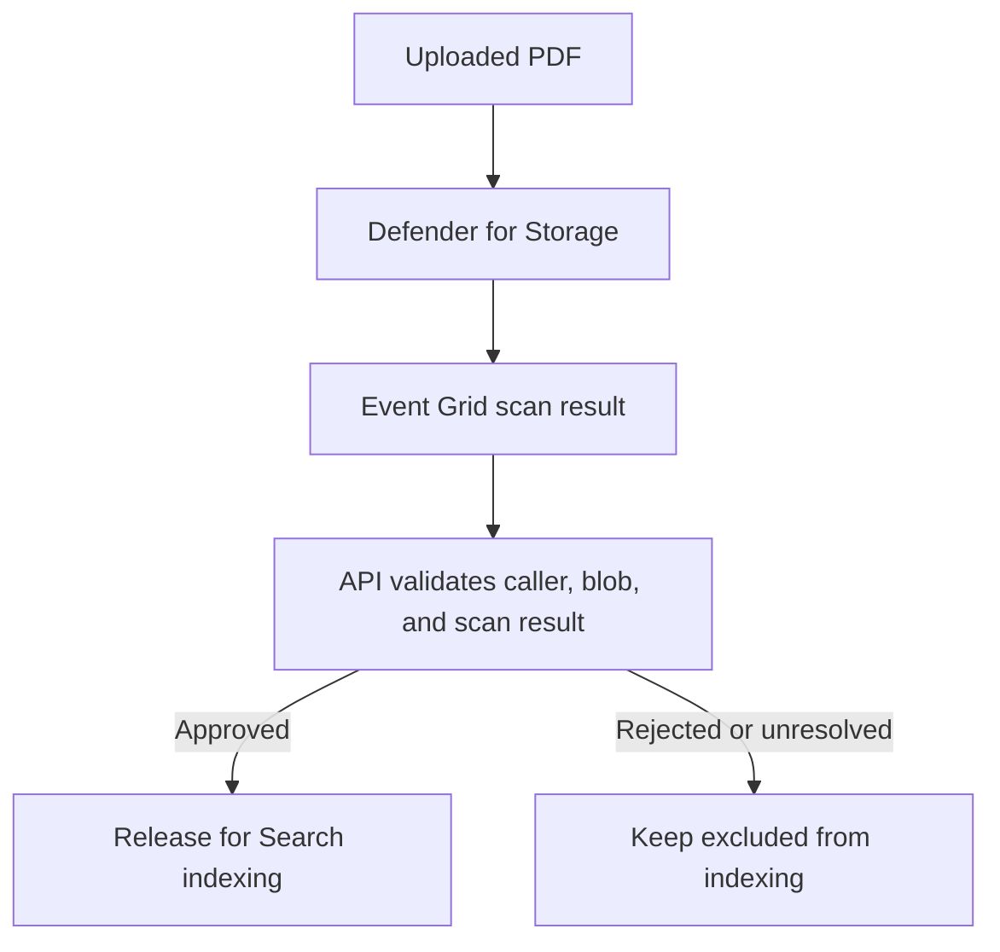

# ProductCare AI

ProductCare AI is a product-support application built with .NET 10, Blazor WebAssembly, and Azure. Users can identify a product from a photo, save its details, upload a manual, ask product-specific questions, and look up U.S. recall information.

The project applies established .NET application patterns to AI integration: the API owns authorization, product ownership, usage limits, and data lifecycle operations. Models handle identification, request routing, and answer generation within application-defined boundaries.

**[Live application](https://productcare.richur.dev/)**

Demo access is reviewed manually. Access is available for scheduled interviews and roles I am actively pursuing. Submit an access request in the application; I will notify you by email after review.

## Demo walkthrough

This walkthrough uses the Xer 321 demo printer. ProductCare reads the model label, lets the user review the detected details, and saves the product.



After upload, the PDF stays out of search while the [security scan is pending](docs/images/manual-scan-pending.png). Once the [manual is ready](docs/images/manual-upload-ready.png), ProductCare Assistant can use it to answer questions about the saved product.



The user can then [ask a follow-up in the same conversation](docs/images/product-assistant-follow-up.png) without repeating the model name.

The screenshots show a demonstration session. Usage limits displayed in those images reflect the configuration at capture time; the checked-in API defaults are listed under [Usage and error handling](#usage-and-error-handling).

## Features

- Product identification from JPEG, PNG, or WebP images, with structured results for review before saving.
- User-scoped product records and coordinated deletion of associated data.
- PDF manual uploads with malware scanning before indexing.
- A streaming ProductCare Assistant that answers questions from uploaded manuals, cites its sources, and keeps context for follow-up questions.
- On-demand recall lookups against the U.S. Consumer Product Safety Commission service.
- Entra External ID sign-in, manual access approval, and administrator account controls.
- Persisted daily usage quotas, telemetry, and automated build and deployment workflows.

## Architecture

The standalone Blazor WebAssembly client calls the ASP.NET Core API using a delegated bearer token. It has no dependency on backend implementation projects and contains no privileged Azure credentials.



Uploaded manuals follow a separate approval path. PDFs are stored with `AzureSearch_Skip=true` and remain excluded from indexing until the scan result has been validated.



Event Grid delivers scan results to a dedicated authenticated webhook using the custom topic's managed identity. Before releasing a manual, the API checks the token, allowed caller, blob location, scanned ETag, and current Defender scan tag.

### Solution layout

| Project | Responsibility |
| --- | --- |
| `src/ProductCare.Web` | Standalone Blazor WebAssembly client |
| `src/ProductCare.Api` | HTTP endpoints, authentication, authorization, and service composition |
| `src/ProductCare.Application` | Use cases, service contracts, and application rules |
| `src/ProductCare.Domain` | Domain models and rules |
| `src/ProductCare.Infrastructure` | EF Core persistence and external integrations |
| `src/ProductCare.AI` | Foundry integration, retrieval, and manual ingestion |
| `tests/ProductCare.UnitTests` | Unit and architecture tests |
| `tests/ProductCare.IntegrationTests` | API and SQL Server integration tests |

### Technology

| Area | Implementation |
| --- | --- |
| Runtime and API | .NET 10, ASP.NET Core |
| Client | Blazor WebAssembly |
| Authentication | Microsoft Entra External ID, MSAL, Microsoft Identity Web |
| Database | EF Core 10 and SQL Server |
| AI | Microsoft Foundry Responses API |
| Retrieval | Azure AI Search with semantic and vector retrieval |
| Manual ingestion | Azure Blob Storage, Defender for Storage, Event Grid |
| Recall data | CPSC SaferProducts.gov API |
| Telemetry | OpenTelemetry and Azure Monitor/Application Insights |
| Hosting | Azure Static Web Apps for the client; Azure Container Apps for the API |
| Delivery | GitHub Actions and Azure Container Registry |
| Tests | xUnit v3, ASP.NET Core integration testing, SQL Server Testcontainers |

## Implementation notes

### Product identification and ownership

The API accepts product images up to 5 MB and validates their content type and file signature before calling the model. Results include manufacturer, model number, product type, product name, confidence, and observed text. Instructions require uncertain fields to remain unset when the image does not provide enough evidence.

Saved products belong to the authenticated tenant and user. Repository operations include both ownership values in their predicates; supplying a product ID alone does not grant access.

### Manual ingestion and answers

Manual upload requires a saved product with a manufacturer and model number. The API accepts one current PDF per product, up to 15 MB, and checks its extension, content type, and `%PDF-` signature.

An accepted upload remains pending until security approval and indexing complete. The status endpoint only reports progress; refreshing the page cannot approve an upload.

For each manual question, the application:

1. Builds the knowledge key from the saved product details and applies product filters.
2. Retrieves a bounded set of chunks using semantic and vector search.
3. Passes retrieved text to the model as untrusted document content.
4. Validates returned citation IDs against the retrieved source set.

When the retrieved evidence does not support an answer, the application returns a no-answer result. Model instructions require answers to stay within that evidence.

### Assistant and conversations

The assistant uses application-controlled orchestration over the Foundry Responses API. A configurable router selects manual retrieval, a recall lookup, both, or neither. ProductCare defines and executes the tools, with bounded execution and no arbitrary HTTP, SQL, file-system, or code-execution access for the model.

Manual follow-up questions are rewritten into self-contained search queries using conversation context. The application retrieves fresh evidence for each question. Answer text streams through the API; the completed structured result is then validated server-side.

Each saved product can retain one active Foundry conversation ID. The conversation is created on the first assistant request and reused for follow-ups. Starting a new conversation clears the stored ID and attempts to delete the previous remote conversation.

The browser transcript is presentation state and is not restored as durable chat history.

### Recall lookup

Recall information comes from the CPSC service rather than model memory. Users can check recalls from the saved product's page; the assistant can also invoke the recall capability for safety-related questions. Matching uses the saved model information and normalized model comparison.

Source failures are reported as unavailable, rather than as an empty recall result. A missing recall match is not proof that a product is safe.

### Access and account lifecycle

Entra External ID handles authentication. ProductCare separately checks the delegated `access_as_user` scope, application access state, and administrative role.

| Policy | Required access |
| --- | --- |
| `ProductCare.User` | Authenticated customer with the delegated API scope |
| `ProductCare.ActiveUser` | Authenticated customer, delegated scope, and active ProductCare access |
| `ProductCare.NotDisabled` | Authenticated customer, delegated scope, and account status other than `Disabled` |
| `ProductCare.Admin` | Authenticated customer, delegated scope, `ProductCare.Admin` role, and account status other than `Disabled` |

The `NotDisabled` policy does not require an active demo subscription; it permits account deletion after access expires. A valid identity with no ProductCare account is not classified as disabled by this policy.

New users can submit an access request. Approval and rejection are administrator-only operations. Suspended users can still authenticate with Entra, but application access checks deny operations requiring active access. Administratively disabled users cannot submit another access request while their disabled account record remains.

Product deletion coordinates removal of indexed chunks, the uploaded manual, the associated Foundry conversation, and the SQL record. Required downstream cleanup completes before the product row is removed. Already-missing resources are tolerated where the downstream API supports it.

Self-service account deletion removes ProductCare-managed data and the local account record for users who are not disabled, including users whose access has expired. Administratively disabled users cannot invoke self-service account deletion. Administrators can suspend or restore access, purge application data while retaining a blocked account, or delete the ProductCare account entirely.

There is currently no separate self-service data-only deletion operation for disabled users. Administrative purge can remove their ProductCare-managed data while retaining the disabled account row. Account deletion and purge do not delete the external Entra identity or guarantee immediate removal of retained backups and operational logs.

Directory identity deletion and session revocation are outside the application's account-management scope.

### Usage and error handling

Daily quotas are stored in SQL Server and enforced using concurrency-safe counter updates. The checked-in defaults in `src/ProductCare.Api/appsettings.json` are configurable by environment:

| Operation | Requests per user per UTC day |
| --- | ---: |
| Product identification | 5 |
| Product manual questions (`ProductKnowledge`) | 30 |
| Product assistant | 30 |

The usage-summary endpoint currently displays identification and assistant quotas; the separate manual-question quota remains enforced on its API endpoint. Manual retrieval invoked within an assistant request does not consume the separate product-knowledge quota.

Exhausted quotas return HTTP `429` with `ProblemDetails`, `Retry-After`, and reset information. Access-request submissions also have a fixed-window rate limit. Global API throttling is not currently enabled.

Validation, conflict, and quota errors are handled centrally. Unexpected exceptions are logged server-side and return a generic response with a trace ID.

### Observability

When configured, OpenTelemetry exports to Azure Monitor/Application Insights. Assistant telemetry includes request and failure counts, tool-call counts, duration, and tracing activities.

Each API request receives a new `X-Correlation-ID`, also used as the ASP.NET Core trace identifier and logging-scope value. GenAI message-content tracing is restricted to Development and requires `Observability:CaptureGenAIContent` to be enabled.

## Build and run locally

Local startup requires configured Azure and identity resources; cloning the repository alone is not enough to run the full application.

### Prerequisites

- .NET 10 SDK and a compatible IDE.
- SQL Server for application data.
- Docker running for SQL Server Testcontainers integration tests.
- Access to the configured Entra External ID tenant and the required Foundry, Search, and Storage resources.
- A supported Azure developer sign-in for local Azure SDK authentication.

### Configuration

Store server-side environment values in .NET User Secrets for `ProductCare.Api`. In Visual Studio, right-click the API project and select **Manage User Secrets**. Use the checked-in configuration and options classes as the reference for exact property names.

| API configuration section | Purpose |
| --- | --- |
| `AzureAd` | Customer authentication and API identity settings |
| `ConnectionStrings:ProductCareDatabase` | SQL Server connection |
| `Foundry` | Model endpoint and deployment settings |
| `ProductKnowledgeSearch` | Search endpoint, index, and semantic configuration |
| `ProductManualIngestion` | Storage and indexer settings |
| `EventGridAuthentication` | Delivery tenant, audience, and allowed caller object ID |
| `UsageQuotas` | Daily operation limits |
| `ApplicationInsights` and `Observability` | Telemetry configuration |
| `Cors` | Allowed client origins |

The WebAssembly client uses public configuration in `AzureAd` and `ProductCareApi` for its authority, client ID, API base URL, and delegated scope. Anything shipped to the browser is readable by users. Do not place client secrets, database credentials, or privileged Azure credentials in the client.

Local webhook authentication settings do not make the local API reachable by Event Grid. End-to-end scan-result delivery requires a reachable HTTPS endpoint.

For a production API deployment, `AzureAd:ClientId` is required; the application fails startup when it is missing.

From the repository root:

```powershell
dotnet restore
dotnet build --configuration Release
dotnet test --configuration Release
```

Run `ProductCare.Api` and `ProductCare.Web` together using Visual Studio's multiple startup projects configuration or separate terminals. Configure the client to call the local API and allow the client origin in the API's CORS settings.

## Testing and delivery

CI restores, builds in Release, and runs tests on pushes and pull requests to `main`. Coverage includes domain and access rules, quotas, architecture dependencies, correlation IDs, health endpoints, authenticated API behavior, SQL-backed product ownership, and product/account lifecycle operations.

Integration tests use `Microsoft.AspNetCore.Mvc.Testing` and Testcontainers for SQL Server. Local Windows application-control policies may prevent integration test assemblies from loading; the Linux CI run independently verifies them.

The client deploys to Azure Static Web Apps with route fallback to `index.html`. The API container is configured to listen on port 8080 and is deployed to Azure Container Apps through GitHub Actions.

The API deployment workflow checks for pending EF Core model changes, creates a migration bundle, signs in to Azure using GitHub OIDC, builds and pushes the image, applies migrations, and updates the Container App with an image tagged by commit SHA.

Azure SDK calls use the Container App's system-assigned managed identity. Its permissions cover the required model, Search, and Storage operations, including indexed-content deletion and Defender blob-index-tag reads.

## Scope and limitations

- Demo access is approved manually, and review notifications are sent manually by email.
- The browser does not restore the previous assistant transcript after a reload.
- Account deletion covers ProductCare-managed data, not the external Entra identity.
- Disabled users cannot self-delete their ProductCare account or independently purge their data; an administrator can purge data while preserving a disabled account record.
- Daily operation quotas are implemented; global API throttling is not.
- AI identification and generated answers can be incorrect. Users should review product details and check the cited manual or recall source.

## Further documentation

- [Architecture](docs/architecture.md)
- [Product scope](docs/product-scope.md)
- [Threat model](docs/threat-model.md)
- [Environments](docs/environments.md)
- [Cost and budget controls](docs/cost-budget.md)
- [ADR 001: Standalone Blazor WebAssembly client](docs/adr/001-frontend-client.md)
