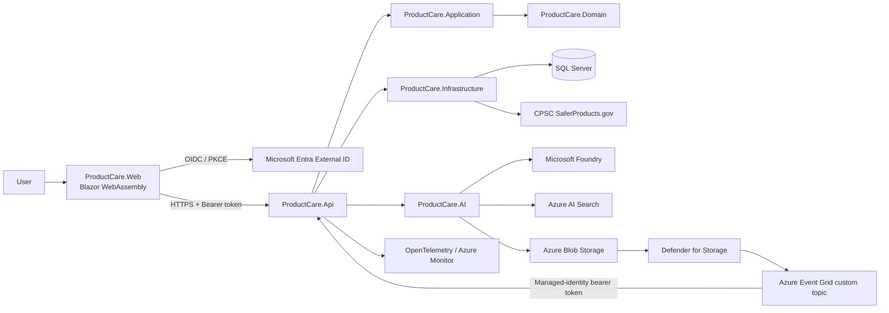

# ProductCare AI

ProductCare is a production-grade product support platform built on .NET 10. It uses Microsoft Foundry for AI orchestration, Azure AI Search for retrieval, Blob Storage for manual storage, Defender for Storage for malware scanning, and Azure Container Apps for API hosting.

The primary design principle is that business and security decisions remain in deterministic server-side code. AI is applied where it provides value (classification, retrieval, response composition), and model output is never treated as an authorization or data-integrity boundary.

## Capabilities

- Image-based product identification with structured output and explicit uncertainty.
- Tenant/user-scoped product ownership.
- Owner-driven product deletion with full downstream cleanup (blob, index chunks, conversation, SQL row).
- Account lifecycle operations: self-delete, admin suspend/restore, and purge-while-blocked.
- Manual upload pipeline with file validation, Defender scan gating, Event Grid webhook, and Search indexing.
- Grounded manual Q&A using semantic + vector retrieval with strict citation validation.
- ProductCare Assistant built on Foundry Responses API with app-defined tools and bounded execution.
- CPSC recall lookups against the source system, not model memory.
- Entra External ID authentication with app-level access approval.
- Persisted daily usage quotas with concurrency-safe enforcement.
- OpenTelemetry + Azure Monitor/Application Insights.
- GitHub Actions CI/CD for web and API deployments.

## Architecture



`ProductCare.Web` is intentionally implemented as a standalone API client. It does not reference backend implementation projects. The API remains the security and application boundary, allowing additional clients (web/mobile) without requiring changes to Domain, Application, Infrastructure, or AI layers.

Manual ingestion is event-driven. Uploaded PDFs remain excluded from Azure AI Search until Defender for Storage reports a clean scan. Event Grid posts the result to a protected webhook using the custom topic's managed identity. Before releasing a file for indexing, ProductCare validates the Event Grid token, blob location, event ETag, and current Defender scan tag.

## Solution Structure

```text
src/
├── ProductCare.Web
├── ProductCare.Api
├── ProductCare.Application
├── ProductCare.Domain
├── ProductCare.Infrastructure
└── ProductCare.AI

tests/
├── ProductCare.UnitTests
└── ProductCare.IntegrationTests

docs/
├── adr/
├── architecture.md
├── cost-budget.md
├── environments.md
├── product-scope.md
└── threat-model.md
```

## Technology

| Area | Current implementation |
| --- | --- |
| Runtime | .NET 10 |
| Client | Standalone Blazor WebAssembly |
| API | ASP.NET Core Web API |
| Customer authentication | Microsoft Entra External ID + MSAL |
| API authorization | Microsoft Identity Web, delegated `access_as_user` scope, application policies |
| Event Grid webhook authentication | Microsoft Entra bearer token from the Event Grid topic system-assigned managed identity |
| Persistence | EF Core 10 + SQL Server |
| AI / orchestration | Microsoft Foundry + Responses API |
| AI safety | Foundry guardrails + application-side validation |
| Retrieval | Azure AI Search semantic + vector retrieval |
| Manual storage | Azure Blob Storage |
| Manual malware scanning | Microsoft Defender for Storage |
| Scan-result delivery | Azure Event Grid custom topic + authenticated HTTPS webhook |
| Product safety | CPSC SaferProducts.gov REST API |
| Observability | OpenTelemetry + Azure Monitor/Application Insights |
| API hosting | Azure Container Apps |
| Web hosting | Azure Static Web Apps |
| Container registry | Azure Container Registry |
| Tests | xUnit v3, ASP.NET Core integration tests, Testcontainers for SQL Server |
| CI/CD | GitHub Actions |

## Core Workflows

### Product Identification

Users may upload JPEG, PNG, or WebP images up to 5 MB.

The API validates both content type and file signature before invoking the model. The identification result is structured and includes manufacturer, model number, product type, product name, confidence, and observed text.

The model is configured to preserve uncertainty. When evidence is insufficient, fields remain unset rather than inferred.

### Product Ownership

Saved products are associated with the authenticated tenant ID and user ID.

Repository reads and updates include both ownership values in the database predicate. A product ID supplied by the client is therefore not sufficient to access another user's product.

### Product and Account Lifecycle

Product deletion is owner-scoped and coordinated across dependent services.

For a saved product, ProductCare removes:

1. Azure AI Search documents associated with the product;
2. the uploaded manual blob, when present;
3. the associated Foundry conversation, when present;
4. the SQL product record.

The SQL row is not deleted until required Azure cleanup has completed. Deletion flows tolerate already-missing resources when the downstream API supports idempotency.

Authenticated users can delete their ProductCare account. Self-service deletion removes ProductCare-managed products, manuals, indexed content, assistant conversations, usage counters, access requests, and the local user-account row. It does not delete the corresponding Microsoft Entra External ID identity.

Administrators have separate lifecycle controls:

- **Suspend** changes the ProductCare account state to `Disabled`. The user remains authenticated by Entra but no longer satisfies `ProductCare.ActiveUser`.
- **Restore** returns an unexpired disabled account to `Active`; an already-expired account returns to `Expired`.
- **Purge data and keep blocked** removes ProductCare-owned application data while retaining the `Disabled` user-account row. This is the containment path when the same external identity must remain blocked from ProductCare.
- **Delete ProductCare account** removes the ProductCare user-account row and application data. Because the external Entra identity remains, this is a data-lifecycle operation rather than a security block.

Directory-level identity disablement, token/session revocation, and Entra identity deletion are intentionally out of scope for this application boundary.

### Product Manuals and Grounded Q&A

A manual can be uploaded only after a saved product has both manufacturer and model number.

The API validates:

- PDF extension;
- `application/pdf` content type;
- `%PDF-` file signature;
- maximum size of 15 MB;
- one current manual per saved product.

A successful upload is neither trusted nor indexed immediately. ProductCare stores the PDF in the private manual container with `AzureSearch_Skip=true`, which keeps the Azure AI Search blob indexer from ingesting the file until security approval completes.

Defender for Storage scans uploads for malware and publishes results to an Event Grid custom topic. The Event Grid subscription calls the ProductCare webhook using the topic's system-assigned managed identity.

The webhook uses a dedicated bearer-token authentication scheme. ProductCare accepts deliveries only when:

1. the Microsoft Entra token is valid for the configured Event Grid webhook audience;
2. the token is issued by the configured Azure resource tenant;
3. the token's object ID matches the configured Event Grid topic managed identity;
4. the event contains a clean Defender malware-scan result;
5. the blob URI belongs to the configured ProductCare storage account, container, and upload path;
6. the scanned ETag matches the current blob;
7. the current Defender blob index tag is exactly `No threats found`.

Only after all checks pass does ProductCare remove `AzureSearch_Skip`, store the approved scan ETag in blob metadata, and trigger the Azure AI Search indexer.

The status endpoint is read-only. Refreshing the UI does not approve or release a manual.

Manual states are:

- `NotUploaded`
- `PendingSecurityScan`
- `SecurityRejected`
- `SecurityScanFailed`
- `PendingIndexing`
- `Ready`
- `Failed`

For a manual question, ProductCare:

1. derives the product knowledge key from the saved manufacturer and model number;
2. filters retrieval to the matching product and uploaded product ID where applicable;
3. combines semantic and vector retrieval;
4. retrieves a bounded set of candidate chunks;
5. wraps retrieved text as untrusted document content before model invocation;
6. requires structured output containing `answerFound`, citation IDs, and the answer;
7. validates every model-provided citation ID against the retrieved source set.

If retrieval evidence does not support an answer, ProductCare returns a no-answer result rather than backfilling from model prior knowledge.

### ProductCare Assistant

The assistant is the primary conversational entry point for product-specific support.

It is implemented as application-controlled orchestration over the Foundry Responses API. Model deployments, instructions, tools, and orchestration rules are versioned with the application.

A configurable router decides whether a request requires:

- product-manual retrieval;
- a CPSC recall lookup;
- both capabilities; or
- no external tool.

Tools are defined and executed by ProductCare. The model is not granted arbitrary HTTP, SQL, file-system, or code-execution access. Tool execution is explicitly bounded.

Manual follow-up requests are rewritten into self-contained search queries using conversation context. Evidence is retrieved again from Azure AI Search for each question.

The router and grounded-answer deployments use the configured Foundry guardrail policy. Content-filter failures are translated into controlled application errors rather than exposed as internal failures.

Grounded answer text is streamed through the API while the completed structured result remains subject to server-side validation.

### Persistent Conversations

Each saved product can hold one active Foundry conversation ID.

The conversation is created lazily on the first assistant request and the ID is persisted with the product. Follow-up requests reuse that conversation so references such as "that step" can be resolved against earlier turns.

Starting a new conversation disconnects the stored conversation ID first and performs best-effort deletion of the previous remote conversation. The next question creates a new conversation.

The browser transcript is currently presentation state; it is not reloaded as durable chat history.

### Recall Checks

Recall data comes directly from the U.S. Consumer Product Safety Commission service, not model memory.

ProductCare searches by model number and performs normalized model matching against returned recall records. If the source is unavailable or payload parsing fails, the app reports the source as unavailable rather than misreporting "no recalls."

A missing recall match is not presented as proof that a product is safe.

## Authentication and Authorization

### Customer Access

ProductCare uses Microsoft Entra External ID for customer authentication.

The Blazor WebAssembly client:

- is a public OAuth client;
- uses redirect-based MSAL authentication;
- requests the delegated ProductCare API scope;
- sends bearer tokens to `ProductCare.Api`;
- contains no privileged Azure credential.

The API defines application authorization levels:

- `ProductCare.User` — authenticated user with the required delegated scope.
- `ProductCare.ActiveUser` — authenticated user with the required scope and active ProductCare access.
- `ProductCare.Admin` — authenticated user with the required scope and the administrative application role.

New users can check access state and submit an access request. Approval and rejection actions are administrator-only.

Application access state is enforced independently of token validity. A user with a `Disabled` ProductCare account can still authenticate with Entra but is denied endpoints requiring `ProductCare.ActiveUser`. This provides administrators with immediate containment without waiting for token expiration.

### Event Grid Webhook Access

The malware-scan webhook does not use customer authentication and does not rely on query-string secrets.

The Event Grid custom topic has a system-assigned managed identity. The subscription uses that identity when posting to the webhook. A dedicated Entra app registration defines the expected token audience.

The API validates Event Grid deliveries through a dedicated JWT bearer scheme and authorization policy. Configuration contains:

```text
EventGridAuthentication:
  TenantId
  Audience
  AllowedCallerObjectId
```

`TenantId` is the Azure resource tenant that issues the Event Grid delivery token.

`Audience` is the application/client ID configured as the Event Grid webhook audience.

`AllowedCallerObjectId` is the object/principal ID of the Event Grid custom topic's system-assigned managed identity.

These values are identifiers, not secrets. They are environment-specific and should not be hard-coded.

## Usage Controls

AI usage is limited per user, per UTC day.

Default limits are:

| Operation | Daily limit |
| --- | ---: |
| Product identification | 20 |
| Product manual questions | 50 |
| Product assistant | 50 |

Quota counters are persisted in SQL Server. Consumption uses conditional updates and a unique-counter creation path so concurrent requests cannot bypass configured limits.

When quota is exhausted, the API returns HTTP `429` with `ProblemDetails`, `Retry-After`, the operation name, the limit, and the UTC reset time.

Access-request submission also uses a fixed-window rate limit.

Global API throttling is not currently enabled.

## Observability

When an Application Insights connection string is configured, the API registers OpenTelemetry with Azure Monitor.

Current assistant telemetry includes:

- request count;
- failure count;
- tool-call count;
- request duration;
- assistant activities;
- Foundry/Azure tracing sources.

GenAI message-content tracing is enabled only in Development and only when `Observability:CaptureGenAIContent` is enabled.

Each API request receives a new `X-Correlation-ID`. The same value is used as the ASP.NET Core trace identifier and included in the logging scope.

## API Error Handling

Validation, conflict, and quota exceptions are handled centrally and returned as safe `ProblemDetails` responses.

Unexpected exceptions are logged server-side and return a generic client response. Problem responses include a trace ID for telemetry correlation.

## Deployment

### Web

`ProductCare.Web` is deployed via Azure Static Web Apps.

The GitHub workflow builds the standalone Blazor WebAssembly client. `staticwebapp.config.json` rewrites unmatched routes to `index.html` for client-side routing.

### API

`ProductCare.Api` is published as a multi-stage .NET 10 container listening on port `8080`.

On pushes to `main`, the deployment workflow:

1. restores local .NET tools;
2. restores the API;
3. checks for pending EF Core model changes;
4. creates a self-contained EF Core migration bundle;
5. validates required GitHub/Azure deployment configuration;
6. signs in to Azure using GitHub OIDC;
7. builds and pushes the API image to Azure Container Registry;
8. applies database migrations;
9. configures Container Apps registry access through managed identity;
10. updates the Container App to the image tagged with the Git commit SHA.

In Azure, SDK access uses the Container App's system-assigned managed identity. Local development uses supported developer credentials.

The managed identity also requires Azure AI Search data-plane permissions to delete indexed manual chunks during product and account deletion. The deployed identity is assigned `Search Index Data Contributor` for that purpose. Blob permissions must continue to allow manual deletion and Defender blob-index-tag reads.

## CI and Testing

The main CI workflow runs on pushes and pull requests to `main`:

```text
restore
  ↓
build --configuration Release
  ↓
test --configuration Release --no-build
```

Automated coverage currently includes:

- domain and access rules;
- quota behavior;
- architecture dependency rules;
- correlation IDs;
- health endpoints;
- authenticated system behavior;
- product ownership against SQL Server;
- product/account lifecycle orchestration;
- administrator suspend and restore behavior.

Integration tests use `Microsoft.AspNetCore.Mvc.Testing` and Testcontainers for SQL Server.

## Local Development

### Prerequisites

- .NET 10 SDK
- Visual Studio or another .NET 10-capable IDE
- access to the configured Microsoft Entra External ID tenant
- access to the required Microsoft Foundry, Azure AI Search, Blob Storage, and SQL resources
- a supported Azure developer sign-in for local Azure SDK authentication

### Server-side Configuration

Do not commit credentials, connection strings, or any privileged secrets.

The API expects environment-specific values for these sections:

```text
AzureAd
ConnectionStrings:ProductCareDatabase
Foundry
ProductKnowledgeSearch
ProductManualIngestion
EventGridAuthentication
UsageQuotas
ApplicationInsights
Observability
Cors
```

The AI/manual-related configuration includes:

```text
Foundry:
  TenantId
  ProjectEndpoint
  ModelDeployment
  RouterDeployment

ProductKnowledgeSearch:
  TenantId
  Endpoint
  IndexName
  SemanticConfigurationName

ProductManualIngestion:
  StorageServiceUri
  ContainerName
  IndexerName

EventGridAuthentication:
  TenantId
  Audience
  AllowedCallerObjectId
```

For local development, store environment-specific server values in .NET User Secrets. Event Grid values can enable local webhook policy validation, but local APIs will not receive Event Grid deliveries unless a public HTTPS endpoint is explicitly exposed.

### Web Configuration

The WebAssembly client contains only public client configuration:

```text
AzureAd:
  Authority
  ClientId
  ValidateAuthority
  KnownAuthorities

ProductCareApi:
  BaseUrl
  Scope
```

The client must not contain client secrets, database credentials, Foundry keys, Search keys, Storage keys, or any other privileged server credential.

### Run

From the repository root:

```powershell
dotnet restore
dotnet build
dotnet test --configuration Release
```

Run `ProductCare.Api` and `ProductCare.Web` using the Visual Studio multi-project launch profile or separate terminals.

## Security Principles

ProductCare keeps security and business authority in deterministic server-side controls:

- identity and authorization;
- product ownership;
- account-state enforcement and administrative suspension;
- access approval;
- quota enforcement;
- upload validation and malware-scan gating;
- authenticated Event Grid delivery;
- CPSC recall retrieval;
- citation validation;
- coordinated product and account data deletion;
- database persistence;
- tool execution boundaries;
- release of uploaded manuals to Search.

User prompts, uploaded files, retrieved chunks, tool output, and model output are all treated as untrusted input.

## Documentation

- [Architecture](docs/architecture.md)
- [Product scope](docs/product-scope.md)
- [Threat model](docs/threat-model.md)
- [Environments](docs/environments.md)
- [Cost and budget controls](docs/cost-budget.md)
- [ADR 001: Standalone Blazor WebAssembly Client](docs/adr/001-frontend-client.md)
